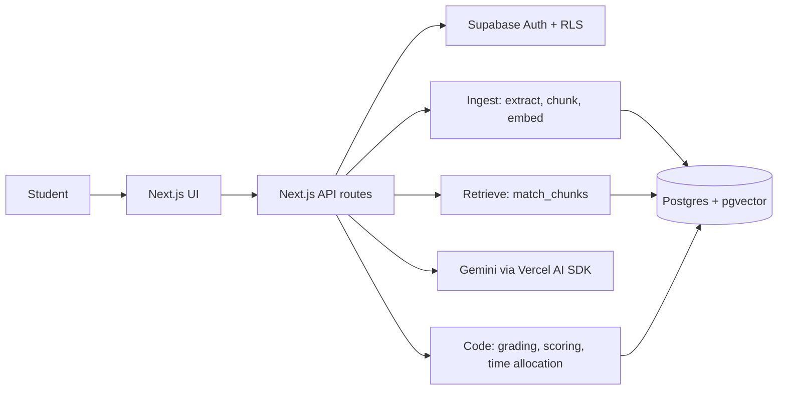

# GapFinder AI: Architecture

## 1. Problem statement
Students study everything equally and still miss what they don't know. Most study tools wait for a question, but a student cannot ask about a gap they don't know they have. GapFinder AI finds the gaps first: it tests the student on their own material, diagnoses weak topics, and builds a plan around them.

## 2. Architecture

## 3. RAG pipeline

| Stage | Detail |
|---|---|
| Extract | `unpdf` for PDFs (page by page); plain text for .txt/.md |
| Chunk | ~2000 chars (~500 tokens), ~200 chars overlap. A heading starts a new chunk (hard boundary). Each chunk stores page + section title. |
| Embed | Gemini `gemini-embedding-001`, 768 dimensions. Documents use `RETRIEVAL_DOCUMENT`, queries use `RETRIEVAL_QUERY`. |
| Store | `chunks` table with `vector(768)` and an HNSW cosine index. |
| Retrieve | `match_chunks()` SQL function: cosine similarity, filtered by user (and optionally by topic or excluding the syllabus). Top-k = 4 for quizzes, 5 for the assistant. |
| Threshold | The assistant only uses chunks above `RAG_MIN_SIMILARITY` (default 0.5). Below it, the answer is "not found in your material". Tune this value with `npm run test:retrieval`. |

## 4. AI workflow: retrieval vs generation

| Feature | Retrieval | Generation (LLM) | Done in plain code |
|---|---|---|---|
| Topic map | Link each topic to its best chunks | Structure the syllabus text into topics | n/a |
| Quiz | Fetch the topic's chunks | Write questions from those chunks only | Validate output, map passage number to real `source_chunk_id`, shuffle options |
| Answer evaluation | Fetch the cited chunk | Explain why the answer is right or wrong | **Grade the answer** |
| Gap analysis | none | Write a one-line reason from the actual wrong answers | **Topic score (difficulty-weighted) and weak/medium/strong rating** |
| Plan | none | Turn the allocation into a day-by-day schedule | **Minutes per topic** (weight = 0.1 + (1 - score)^2) |
| Assistant | Fetch top-k chunks above the threshold | Answer using only those chunks, with citations | Refuse when nothing passes the threshold |

**How the two are kept separate:** the LLM never sees anything except retrieved passages (or the student's actual quiz results). It returns a passage *number*, which code maps to a real chunk ID, so every question and citation points to a verified chunk. All numbers (scores, ratings, time) are computed in code, so the diagnosis is measurable and reproducible.

**Rating thresholds:** under 40% weak, 40-70% medium, over 70% strong. Difficulty weights: easy 1, medium 2, hard 3.

## 5. Security
Supabase Auth (email + password). Row Level Security on every table (`user_id = auth.uid()`). `correct_answer` is never sent to the browser before submission. The service-role key is used only by the local seed script.

## 6. Limitations
- Scanned PDFs (images) are not supported; there is no OCR.
- Heading detection is heuristic; unusual formatting may produce larger chunks without a section title.
- Quiz quality depends on the uploaded material; thin notes give thin questions. Questions are multiple choice only.
- Topic scores come from a few questions per topic, so they are an estimate. More attempts improve accuracy.
- Quiz generation takes 20-40 seconds (free-tier rate limits); very large syllabi are truncated to ~24k characters.
- English only.

## 7. Future enhancements
Class-level analytics for teachers, parent progress view, multi-subject and multi-language support, spaced-repetition reminders, LMS integration, OCR for scanned files, short-answer questions graded against the source, adaptive quizzes that target weak topics.
